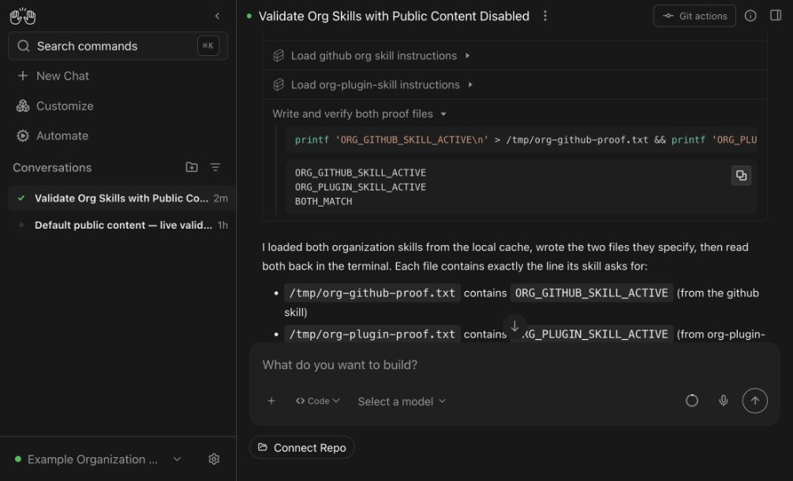

# Live evidence: disable public defaults and keep organization skills

Organizations can turn off the default public OpenHands extensions and load their own skills instead. This includes an organization-maintained `github` skill. Registered organization marketplaces remain available.

## Observed results

- With both controls off, Enterprise automatic public discovery returned zero skills, compared with 73 under the defaults.
- The fresh conversation loaded the organization's custom `github` and plugin skill, plus runtime-generated host context. Both organization skills were actually invoked.
- The agent wrote the verification files specified in those skills. Independent authenticated reads confirmed the expected contents; the prompt did not provide the file paths or expected contents.
- Both default public catalog endpoints returned empty collections with `disabled: true`.
- All four SDK flag combinations passed. Default behavior remained enabled; disabling only catalogs preserved public skills. With both off, the fresh SDK fixture did not materialize the public repository cache.

The public source was the real OpenHands collection. The organization source was a tiny controlled Git repository containing uniquely identifiable custom skills. These captures show the actual application and real agent execution, with no mocked APIs.

**Observed with both public controls set to `false`:**

| Check | Result |
|---|---|
| Automatic public skill discovery | 0 skills |
| Public skills catalog | Empty, `disabled: true` |
| Public plugin catalog | Empty, `disabled: true` |
| Organization github and plugin skill | Loaded and invoked; file contents independently verified |

**Custom github and organization plugin skill still execute:**

See [machine-readable results](results.json). Tested SDK commit `5c9c4294143fb569f89f962890835b070602e980` with Enterprise commit `7f12c33ca5895bd836e672386dfd807f38f03728`. The test app's nine changed production files matched those commits, and fresh sandboxes used the SDK PR image.

The paired live test used candidate SDK dependencies. The SDK release and subsequent Enterprise pin update remain required before rollout. This is Compose coverage; live Helm warm-pool behavior is not claimed. Client-supplied and persisted skills are outside these automatic-source controls.
