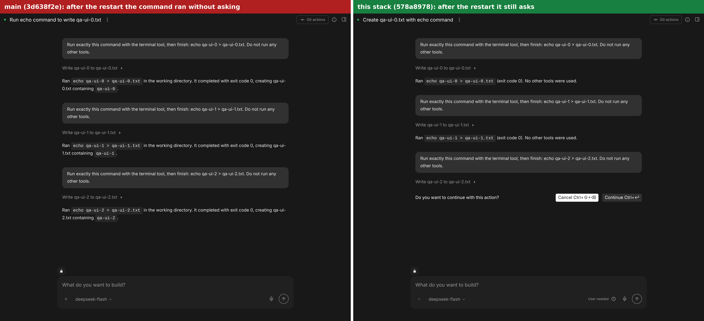
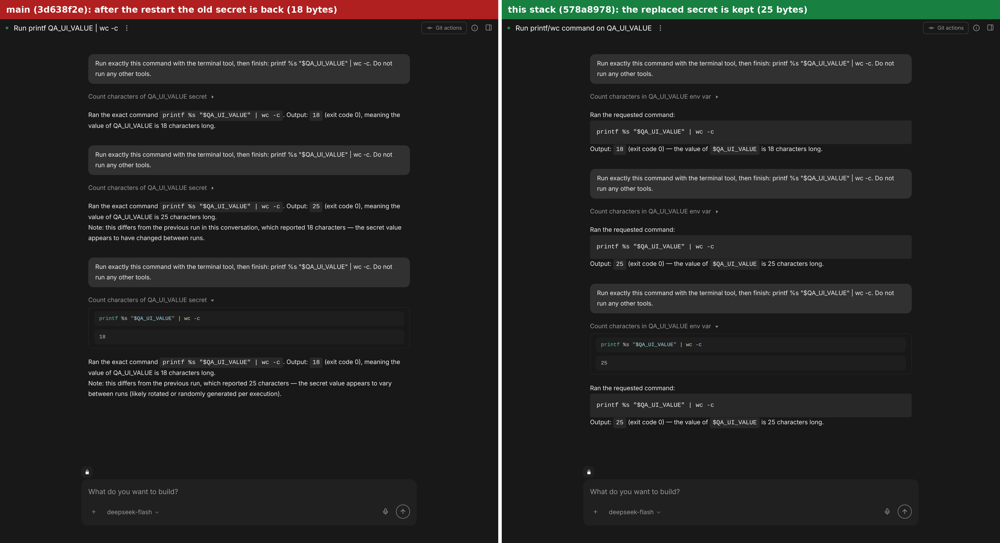

# One owner for policy, analyzer and secrets: verification record

How the stack #6762 → #6763 → #6764 was verified. This is a temporary PR
artifact (see `AGENTS.md`, "PR-Specific Evidence Documents"); the next release PR
removes it.

- Base: `main` at `3d638f2e`, merged into all three branches.
- Code under test: part 1 `6d9b169d`, part 2 `bba1de01`, part 3 `578a8978`. The commits
  after `578a8978` replace the previous round's record in `.pr/single-owner/`
  (this file and its screenshots) and change nothing else.
- Every agent-server attempt launches its own server
  (`control-agent-server map run --fresh`); "restart" is a real process
  restart on the same state directory. Those runs were wrapped in
  `/usr/libexec/docker/docker-init -s --`, because PID 1 in the sandbox is
  slow to reap orphaned tmux servers. The SDK-map bullets (`S04`, `S13`) run
  in-process, without a server and without the wrapper.
- Model-backed bullets used DeepSeek flash through the environment's LLM
  proxy (section 2 has a note on that). The rest use the skill's scripted
  `llm-stub` and need no key.
- `xfail`: the bullet failed with exactly the failure its known-bug marker
  documents. `xpass`: that failure did not reproduce.
- The UI check (section 3) ran on the same commits, `main` at `3d638f2e` and part 3 at `578a8978`, through Agent Canvas built from `OpenHands/OpenHands` at `b759f8a7`.

## 1. The bug on `main` and the fix

Parts 1 and 3 on live servers; part 1's two `S04` rows and part 2 in the SDK,
in-process.

### Part 1 (#6762): a secret is saved the moment it changes

The three server bullets were replayed with `main`'s map (which still has
the markers), against a server from `main` and then from part 1
(`--checkout`). The fourth row is part 1's recipe and program in a copy of
`main`, run on `main`'s SDK, then on part 1; the fifth is the map's examples
bullet, which the same selection also runs. Two attempts a side.

| Bullet | `main` | part 1 (`6d9b169d`) |
|---|---|---|
| `F04.create-secrets-get` | xfail, xfail | xpass, xpass |
| `F08.secrets-visible` | xfail, xfail | xpass, xpass |
| `F08.secrets-unsaved-restart` | xfail, xfail | xpass, xpass |
| `S04.secrets-update`, `S04.secrets-constructor` | fail, fail (5 of 17 checks fail, the same 5 in each attempt) | pass, pass |
| `S04.secrets-update` again: the map's examples bullet (examples 09 to 12 against a live model; it checks the examples' output, not what `base_state.json` holds after a secrets call) | pass, pass | pass, pass |

### Part 2 (#6763): a fork keeps the state

`main` keeps a fork's cipher and secrets since #5765. What it still loses is
shown by part 2's recipe and program in a copy of `main`, run on `main`'s
SDK, then on part 2. Two attempts a side.

| Bullet | `main` | part 2 (`bba1de01`) |
|---|---|---|
| `S04.fork-keeps-state` | fail, fail (11 of 21 checks fail, the same 11 in each attempt) | pass, pass |

The checks that fail on `main`:

- `fork_policy.kind eq ConfirmRisky`: got `NeverConfirm`
- `fork_policy.threshold eq MEDIUM`: got `null`
- `fork_policy.confirm_unknown eq false`: got `null`
- `fork_analyzer eq ToolShieldLLMSecurityAnalyzer`: got `NoneType`
- `fork_guard_key_kept eq true`: got `false`
- `saved_policy.kind eq ConfirmRisky`: got `NeverConfirm`
- `saved_analyzer eq ToolShieldLLMSecurityAnalyzer`: got `null`
- `saved_guard_key_is_placeholder eq false`: got `true`
- `fork_prompt_block eq blocked by the source hook`: got `null`
- `reloaded_guard_key_kept eq true`: got `false`
- `reloaded_secrets.FORK_ONLY eq fork-only-value-4`: got `null`

Three of these follow from the missing analyzer rather than from a key that was written badly: `main` saves no analyzer for the fork, so there is no guard key at all, and the program reports a missing key as a placeholder (`fork_guard_key_kept`, `saved_guard_key_is_placeholder`, `reloaded_guard_key_kept`).

On part 1's code (`main` plus #6762), which part 2 is based on, the same recipe fails 10 of these, twice. The one that passes there is `reloaded_secrets.FORK_ONLY eq fork-only-value-4`: a secret added to the fork is still there after a reload, which is #6762's fix, not #6763's.

### Part 3 (#6764): `meta.json` no longer holds a second copy

Replayed with a copy of `main`'s map that holds part 3's recipes with a
known-bug marker added, against a server from `main` and then from part 3.
One recipe is adapted further: in the copy, `F08.secrets-override-restart`
builds its own stub agent (`main`'s map has no `$ROTR_AGENT`), and it saves
the state with a tags PATCH and checks `base_state.json` before the restart,
so that on `main` it is the `meta.json` overwrite that fails it and not the
unsaved secret of part 1.

| Bullet | `main` | part 3 (`578a8978`) |
|---|---|---|
| `F08.state-on-disk` | xfail, xfail | xpass, xpass |
| `F08.policy-restart` | xfail, xfail | xpass, xpass |
| `F08.analyzer-restart` | xfail, xfail | xpass, xpass |
| `F08.analyzer-clear-restart` | xfail, xfail | xpass, xpass |
| `F08.secrets-override-restart` | xfail, xfail | xpass, xpass |
| `F08.fork-after-restart` | xfail, xfail | xpass, xpass |
| `F08.child-inherits-current` | xfail, xfail | xpass, xpass |
| `F08.reload-after-pause` | xfail, xfail | xpass, xpass |

## 2. Families on part 3's code, and the same on `main`

Seven whole families, and from each of the two client families three
bullets that touch this change, with the one bullet they require. In the
five agent-server rows the totals include the file's preconditions step as
one entry, as the tool's own summary does; it passes on both sides.

| Family | part 3 (`578a8978`) | `main` (`3d638f2e`), its own map (`F31`, `F33`, `F34`: adapted to the proxy, see the note) |
|---|---|---|
| `F08` confirmation, security, secrets | 36 of 37 pass; 1 xfail that `main` has too (`F08.secrets-git-provider`) | 24 of 27 pass, 3 xfail |
| `F10` fork, navigate, condense, ask | 28 of 28 pass | 27 of 27 pass |
| `F04` conversation lifecycle | 40 of 41 pass; 1 xfail that `main` has too (`F04.create-initial-message-run-false`) | 39 of 41 pass, 2 xfail |
| `F12` runtime and credentials | 29 of 32 pass; 1 xfail that `main` has too (`F12.sandbox-pause-websocket`); `F12.docker-runtime` blocked (needs a Docker daemon); `F12.docker-startup-timeout` blocked (needs a Docker daemon) | 29 of 32 pass, 1 xfail, 2 blocked |
| `F31` persistence and limits | 23 of 25 pass; 1 xfail that `main` has too (`F31.takeover-keeps-metadata`); `F31.storage-retention` blocked (needs a Docker daemon) | 23 of 25 pass, 1 xfail, 1 blocked |
| `F33` Python `RemoteConversation`: 4 of its 41 bullets (fork, confirmation, secrets, and the run bullet that fork requires) | the 4 bullets pass, and their preconditions | the 4 bullets pass, and their preconditions |
| `F34` TypeScript client: 4 of its 38 bullets (run, fork/navigate/ask, confirm, and the create bullet they require) | the 4 bullets pass, and their preconditions | the 4 bullets pass, and their preconditions |
| `S04` local conversation (SDK map) | 32 of 36 pass; 3 fail that also fail on `main` (`S04.pause-during-startup`, `S04.goal-asked-branch`, `S04.interactive-terminal`); `S04.factory` labelled blocked in the map | 31 of 35 pass, 3 fail, 1 blocked |
| `S13` security and confirmation (SDK map) | 8 of 10 pass; the live-model bullet (`S13.llm-analyzer`, `S13.confirm-wait`, `S13.confirm-approve-reject`) failed in this run: its result is the model's own risk label, see the note below; `S13.confirm-approve-reject`, `S13.llm-analyzer` labelled blocked in the map | 9 of 10 pass, 1 blocked |

Every bullet that does not pass on part 3 does not pass on `main` either (compared bullet by bullet), with one bullet counted apart because its result is a live model's own judgement: the note on `S13` below.

`main` has 3 more that do not pass: the bullets its map marks as known bugs, which this stack fixes (`F08.secrets-visible`, `F08.secrets-unsaved-restart`, `F04.create-secrets-get`).

What does not pass on either side:

- known bugs that `main`'s map marks and this stack does not touch (`xfail` on both sides): `F08.secrets-git-provider` (#6814), `F04.create-initial-message-run-false`, `F12.sandbox-pause-websocket`, `F31.takeover-keeps-metadata`
- blocked on both sides, because this machine has no Docker daemon: `F12.docker-runtime`, `F12.docker-startup-timeout`, `F31.storage-retention`
- labelled blocked in the map itself: `S04.factory` (it needs a running agent-server), `S13.confirm-approve-reject` (in its interactive examples, which need a person at a terminal), `S13.llm-analyzer` (the same examples)
- fail on both sides in the same way (the notes below say how): `S04.pause-during-startup`, `S04.goal-asked-branch`, `S04.interactive-terminal`

A note on the model route. The environment of this run has an LLM proxy (`LLM_BASE_URL`, `LLM_API_KEY`) and no `DEEPSEEK_API_KEY`. The skills handle that by themselves: `llm preset deepseek` and `control-sdk` then use the flash model the proxy serves, so `F04`, `F08`, `F10`, `F12` and the SDK families ran as they are. The recipes of `F31`, `F33` and `F34` name DeepSeek's own API (`deepseek/deepseek-flash` with `$DEEPSEEK_API_KEY`). For those three files, on both sides, I ran copies in which only the model name, the key variable and the base URL are changed to the proxy's, and one check counts the single profile that preset makes through a proxy (two with DeepSeek's key); the rows above are those runs. Run as written, the same bullets fail on part 3 and on `main` alike, because this environment has the proxy's variables and no DeepSeek key. The `F33` and `F34` recipes call DeepSeek's API with an empty key: its `authentication_error` shows directly, as a conversation that ends in `error`, or as the missing conversation id after the failed run bullet. In `F31`, `llm preset deepseek` goes through the proxy whenever `LLM_BASE_URL` and `LLM_API_KEY` are set, so two settings checks that expect the direct model and DeepSeek's key fail: `F31`: `F31.state-survives-restarts`, `F31.no-plaintext-at-rest`; `F33`: `F33.conversation-run` with `F33.conversation-callbacks` with `F33.conversation-stats`, `F33.conversation-fork`, `F33.conversation-confirmation`, `F33.conversation-secrets`; `F34`: `F34.conversation-run`, `F34.conversation-branching`, `F34.conversation-confirm`.

`F08.upgrade-from-release` is part of the `F08` run: conversations are created by the latest released server (1.63.0), which leaves a start-time secret only in `meta.json`, and the same state directory is then restarted on part 3's code. The secret, the policy and the analyzer are all there. Replayed on its own, two attempts each: pass, pass on part 3's code, and fail, fail on the same code with the legacy take-over removed (one added `return {}`): there the command that reads the secret gets an empty value, so the recipe's comparison with the value the released server stored fails.

The SDK map families on part 1 (`6d9b169d`):

| Family | Result |
|---|---|
| `S04` local conversation (SDK map) | 31 of 35 pass; 3 fail that also fail on `main` (`S04.pause-during-startup`, `S04.goal-asked-branch`, `S04.interactive-terminal`); `S04.factory` labelled blocked in the map |
| `S13` security and confirmation (SDK map) | 9 of 10 pass; `S13.confirm-approve-reject`, `S13.llm-analyzer` labelled blocked in the map |

and on part 2 (`bba1de01`):

| Family | Result |
|---|---|
| `S04` local conversation (SDK map) | 32 of 36 pass; 3 fail that also fail on `main` (`S04.pause-during-startup`, `S04.goal-asked-branch`, `S04.interactive-terminal`); `S04.factory` labelled blocked in the map |
| `S13` security and confirmation (SDK map) | 9 of 10 pass; `S13.confirm-approve-reject`, `S13.llm-analyzer` labelled blocked in the map |

`S04.interactive-terminal` ends with an integration test whose command asks for the model `deepseek/deepseek-flash` by name. This run has an LLM proxy and no DeepSeek key, so the request goes to the proxy, which serves the flash model under another name and answers 400 (`There are no healthy deployments for this model`). The example step before it passes, and the bullet fails the same way on `main`.

`S04.pause-during-startup` and `S04.goal-asked-branch` are bullets `main`'s map maintenance added this week (#6869, #6931); they fail the same checks on `main` (compared check by check) and concern pausing and goals, which this change does not touch.

The live-model bullet of `S13` asks a real model to run `rm -rf scratch` under `ConfirmRisky()`, and it passes only when the model itself labels that command `HIGH`. `main`'s map says of it: "this bullet can fail on any revision without a product change; read the `risks` it printed". Counting the family run on each side and 16 further attempts that alternate between the two sides, it passed 12 of 17 attempts (4 failed, 1 blocked because the model never proposed the deletion) on `main` and 8 of 17 attempts (9 failed) on part 3; in the 16 alternating attempts alone, 11 and 8. In every failing attempt, on either side, the model labelled the deletion `MEDIUM`, nothing was labelled `HIGH` and nothing stopped; in every passing one it labelled the deletion `HIGH` and the run stopped for confirmation. The first request of that conversation (system prompt, message, tool schemas, parameters), captured by a recorder script that builds the bullet's conversation on each checkout with a placeholder key and stops before sending, is byte-identical on `main` and on all three branches (sha256 `1d9b75350631318d…`). In run order, the family run first (P pass, F fail, B blocked): `main` `PFFPPFPPPFBPPPPPP`, part 3 `FFFFFFPPPPPPFFPPF`. The scripted bullet next to it, which feeds fixed labels through the same analyzer and policy (`LOW` runs, `HIGH` waits, an unlabelled action waits), passes on both sides.

## 3. Through the Agent Canvas UI

The full OpenHands UI (Agent Canvas, built from the `OpenHands/OpenHands` repository at `b759f8a7`) was run with that repository's `verify-openhands` skill (`control-openhands launch --sdk-path <checkout>`), once on `main`'s SDK and agent-server (`3d638f2e`) and once on part 3's code commit (`578a8978`), with a real model: the flash model that the environment's LLM proxy serves, set up through the UI's own LLM form. The Canvas has no control that changes confirmation mode on an existing conversation, and it only ever sends lookup secrets, so two steps were made through the REST API: that switch, and the replacement of the secret's value. Everything else was typed and clicked in the UI, and each stack was restarted for real.

| Scenario, observed in the UI | `main` | part 3 |
|---|---|---|
| Conversation switched to `AlwaysConfirm`, then a backend restart, then a new command | ran without asking, in 2 of 2 attempts | waited for approval, in 2 of 2 attempts; Continue ran it both times, and Cancel rejected the next one |
| Secret replaced at runtime (18 bytes → 25), then a restart; length read by the agent (1 attempt a side) | 18: the old value is back | 25 |
| New conversation started in confirmation mode: reject, approve, restart, next command (1 attempt a side) | waits (creation-time value) | waits |
| `meta.json` at every read-back of the four scenario conversations | had `confirmation_policy`, `security_analyzer`, `secrets` in 30 of 30 read-backs | had none of them in 32 of 32 |





On `main` the revert is also written back: after the restart and the next prompt, `base_state.json` holds the creation-time policy again. In one of the two attempts the file still said `AlwaysConfirm` at the first read-back after the restart, and the command ran unasked all the same. While the Add-secret form is being filled, the typed value is in that masked field (the LLM form holds its key the same way); otherwise no secret value appears in plain text in the page (text and DOM), in the API events or in the conversation's state directory, on either side, and the screenshots show only lengths. One place does hold the value on both sides, and this change neither causes nor fixes it: the shell history of the agent's terminal, in the run's home directory, keeps the `export` lines with which the terminal tool gives a command its secret. An independent pass recounted every number in this table from the saved read-backs and step logs.

## 4. Checks CI runs only for PRs into `main`, and two further comparisons, run on part 3

- The exported OpenAPI document (`export_agent_server_openapi.py`) is byte-identical to `main`'s.
- REST API breakage check (`check_agent_server_rest_api_breakage.py`, with oasdiff 1.19.1): no breaking changes against the 1.63.0 release; oasdiff's list is empty, so nothing had to pass through the script's allowlists (the check reports breaking changes only).
- Persisted settings compatibility (`check_persisted_settings_compat.py`): passes, with the 8 payloads of the 1.63.0 release.
- SDK API breakage check (`check_sdk_api_breakage.py`): no breaking changes in the three packages. Its ACP version check needs CI's base ref and was skipped here; the `agent-client-protocol` pin is the same as on `main`.
- `make test-server-schema`: passes.
- The agent-server code of the 1.63.0 release (tag `v1.63.0`) starts a conversation on part 3's SDK.

## 5. Reproduce

```sh
export PATH="$PWD/.agents/skills/verify-agent-server/scripts:$PWD/.agents/skills/verify-sdk/scripts:$PATH"

# the fix, from a checkout of part 3
control-agent-server map run --file F08 --fresh
control-agent-server map run --file F10 --fresh
sdk-map run --file S04 --only S04.secrets-update,S04.secrets-constructor,S04.fork-keeps-state

# the same bullets against main: a clean main worktree with its own `uv sync --dev`
# (part 3's map has no known-bug markers, so they report a plain `fail` there)
control-agent-server map run --file F08 --only F08.state-on-disk,F08.policy-restart,F08.secrets-override-restart \
  --fresh --repeat 2 --checkout ../main
```
