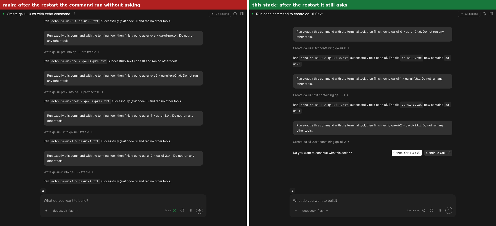
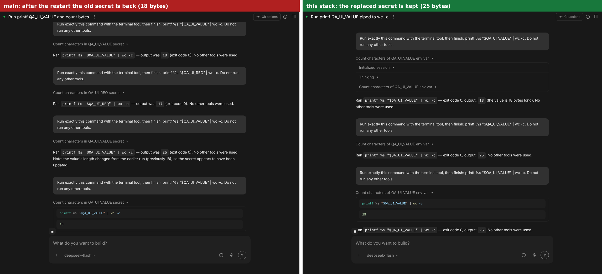

# One owner for policy, analyzer and secrets: verification record

How the stack #6762 → #6763 → #6764 was verified. This is a temporary PR
artifact (see `AGENTS.md`, "PR-specific artifacts"); the next release PR
removes it.

- Base: `main` at `56d559f6`.
- Code under test: part 1 `c0fa0cd4`, part 2 `f584d5db`, part 3 `4b4d01c7`. The commit
  that adds this file changes nothing else.
- Every live attempt launches its own agent-server
  (`control-agent-server map run --fresh`); "restart" is a real process
  restart on the same state directory. Runs were wrapped in
  `/usr/libexec/docker/docker-init -s --`, because PID 1 in the sandbox is
  slow to reap orphaned tmux servers.
- Model-backed bullets used DeepSeek flash. The rest use the skill's
  scripted `llm-stub` and need no key.
- `xfail`: the bullet failed with exactly the failure its known-bug marker
  documents. `xpass`: that failure did not reproduce.

## 1. The bug on `main` and the fix, on live servers

### Part 1 (#6762): a secret is saved the moment it changes

Replayed with `main`'s map (which still has the markers), against a server
from `main` and then from part 1 (`--checkout`).

| Bullet | `main`, 2 attempts | this branch, 2 attempts |
|---|---|---|
| `F04.create-secrets-get` | xfail, xfail | xpass, xpass |
| `F08.secrets-visible` | xfail, xfail | xpass, xpass |
| `F08.secrets-unsaved-restart` | xfail, xfail | xpass, xpass |

SDK map, `S04.secrets-update` and `S04.secrets-constructor`: fail on `main`
(`saved_after_update: []`), pass on part 1.

### Part 2 (#6763): a fork keeps the state

| Bullet | `main`, 2 attempts | this branch, 2 attempts |
|---|---|---|
| `F10.fork-keeps-credentials` | xfail, xfail | xpass, xpass |
| `F10.fork-run-memory` | xfail, xfail | xpass, xpass |

SDK map, `S04.fork-keeps-state`: fails 15 checks on `main`, passes on part 2.

### Part 3 (#6764): `meta.json` no longer holds a second copy

Replayed with a copy of `main`'s map in which these recipes carry a
known-bug marker, against a server from `main` and then from part 3.

| Bullet | `main`, 2 attempts | this branch, 2 attempts |
|---|---|---|
| `F08.state-on-disk` | xfail, xfail | xpass, xpass |
| `F08.policy-restart` | xfail, xfail | xpass, xpass |
| `F08.analyzer-restart` | xfail, xfail | xpass, xpass |
| `F08.analyzer-clear-restart` | xfail, xfail | xpass, xpass |
| `F08.secrets-override-restart` | xfail, xfail | xpass, xpass |
| `F08.fork-after-restart` | xfail, xfail | xpass, xpass |
| `F08.child-inherits-current` | xfail, xfail | xpass, xpass |
| `F08.reload-after-pause` | xfail, xfail | xpass, xpass |

## 2. Whole families on part 3's code

| Family | Result |
|---|---|
| `F08` confirmation, security, secrets | 34 of 34 pass |
| `F10` fork, navigate, condense, ask | 27 of 27 pass |
| `F04` conversation lifecycle | 36 pass; 1 xfail that `main` has too (`F04.create-initial-message-run-false`) |
| `F12` runtime and credentials | 29 pass; 1 xfail that `main` has too (`F12.sandbox-pause-websocket`); `F12.docker-runtime` blocked (needs a Docker daemon); `F12.docker-startup-timeout` blocked (needs a Docker daemon) |
| `F31` persistence and limits | 22 pass; 1 xfail that `main` has too (`F31.takeover-keeps-metadata`); `F31.storage-retention` blocked (labelled blocked in the map) |
| `F33` Python `RemoteConversation`: run, fork, confirmation, secrets | 5 of 5 pass |
| `F34` TypeScript client: create, run, fork/navigate/ask, confirm | 5 of 5 pass |
| `S04` local conversation (SDK map) | 25 pass; 1 fail that `main` has too (`S04.persist-events`, `S05.event-log-recovery`); `S04.factory` labelled blocked in the map |
| `S13` security and confirmation (SDK map) | 7 pass; `S13.llm-analyzer`, `S13.confirm-wait`, `S13.confirm-approve-reject` blocked this time: the model did not propose the risky command the bullet needs; `S13.confirm-approve-reject`, `S13.llm-analyzer` labelled blocked in the map |

SDK maps on parts 1 and 2:

| Family | Result |
|---|---|
| `S04` local conversation (SDK map) | 24 pass; 1 fail that `main` has too (`S04.persist-events`, `S05.event-log-recovery`); `S04.factory` labelled blocked in the map |
| `S13` security and confirmation (SDK map) | 8 pass; `S13.confirm-approve-reject`, `S13.llm-analyzer` labelled blocked in the map |

| Family | Result |
|---|---|
| `S04` local conversation (SDK map) | 25 pass; 1 fail that `main` has too (`S04.persist-events`, `S05.event-log-recovery`); `S04.factory` labelled blocked in the map |
| `S13` security and confirmation (SDK map) | 7 pass; `S13.llm-analyzer`, `S13.confirm-wait`, `S13.confirm-approve-reject` blocked this time: the model did not propose the risky command the bullet needs; `S13.confirm-approve-reject`, `S13.llm-analyzer` labelled blocked in the map |

The `S04.persist-events` / `S05.event-log-recovery` bullet fails the same way on `main`. The model-backed `S13.llm-analyzer` bullet needs DeepSeek to propose a risky command and to rate it `HIGH`; when the model does not, the bullet reports `blocked` or `fail`, on `main` as well (repeated alone it failed 1 time in 3 on `main` and 2 in 3 on the stack). Neither touches this change.

## 3. Through the Agent Canvas UI

The full OpenHands UI (Agent Canvas, built from the `OpenHands/OpenHands` repository) was run with that repository's `verify-openhands` skill (`control-openhands launch --sdk-path <checkout>`), once on `main`'s SDK and agent-server and once on this branch's, with a real model (DeepSeek flash). The Canvas has no control that changes confirmation mode on an existing conversation, and it only ever sends lookup secrets, so two steps were made through the REST API: that switch, and the replacement of the secret's value. Everything else was typed and clicked in the UI, and each stack was restarted for real.

| Scenario, observed in the UI | `main` | this branch |
|---|---|---|
| Conversation switched to `AlwaysConfirm`, then a backend restart, then a new command | ran without asking, in 2 of 2 attempts | waited for approval, in 2 of 2 attempts; Continue ran it, Cancel rejected it |
| Secret replaced at runtime (18 bytes → 25), then a restart; length read by the agent | 18: the old value is back | 25 |
| New conversation started in confirmation mode: reject, approve, restart, next command | waits (creation-time value) | waits |
| `meta.json` read back at every step | had `confirmation_policy`, `security_analyzer`, `secrets` in 25 of 25 read-backs | had none of them in 21 of 21 |





On `main` the revert is also written back: loading the conversation after the restart overwrote `base_state.json` with the creation-time policy. No secret value appears in the page (text and DOM), in the API events or in the conversation's state directory, and the screenshots show only the lengths.

## 4. Checks CI runs only for PRs into `main`, run on part 3

- The exported OpenAPI document (`export_agent_server_openapi.py`) is byte-identical to `main`'s.
- REST API breakage check (`check_agent_server_rest_api_breakage.py`, with oasdiff 1.19.1): no breaking changes.
- Persisted settings compatibility (`check_persisted_settings_compat.py`): passes, the payloads of the 1.62.0 release included.
- SDK API breakage check (`check_sdk_api_breakage.py`): no breaking changes in the three packages.
- `make test-server-schema`: passes.
- `main`'s agent-server code (the released 1.62.0) starts a conversation on this branch's SDK.

## 5. Reproduce

```sh
export PATH="$PWD/.agents/skills/verify-agent-server/scripts:$PWD/.agents/skills/verify-sdk/scripts:$PATH"

# the fix, from a checkout of part 3
control-agent-server map run --file F08 --fresh
control-agent-server map run --file F10 --fresh
sdk-map run --file S04 --only S04.secrets-update,S04.secrets-constructor,S04.fork-keeps-state

# the same bullets against main: a clean main worktree with its own `uv sync --dev`
control-agent-server map run --file F08 --only F08.state-on-disk,F08.policy-restart,F08.secrets-override-restart \
  --fresh --repeat 2 --checkout ../main
```
